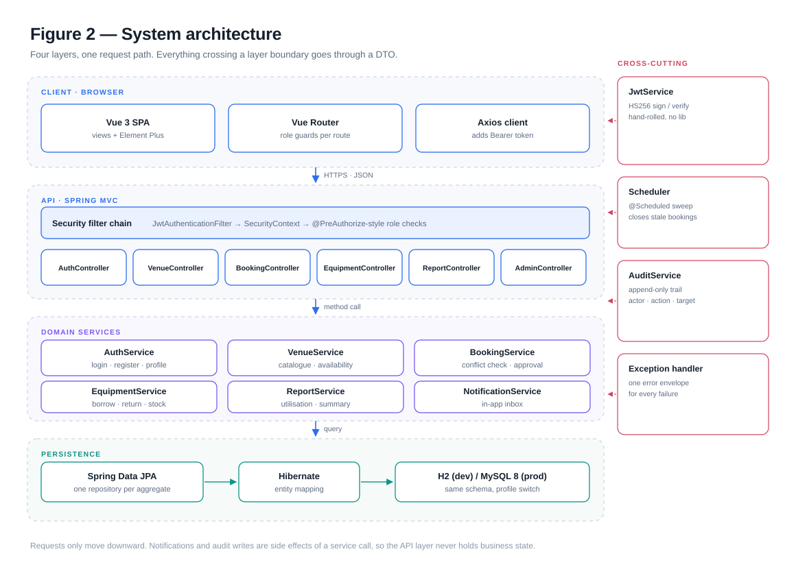

# Campus Venue Booking

A booking and approval system for school sports facilities. Students reserve a court or a pitch,
teachers decide on the requests that take a venue away from other people, and admins keep the
catalogue and read utilisation numbers.

Built for the shape of a middle or high school: a handful of venues (volleyball, badminton,
football, indoor and outdoor tennis, squash, table tennis), one shared weekly timetable, and a lot
of people who want the same hour after class.

**[Open the live preview →](https://campus-venue.app.workbuddy.host/?sharecode=W2TN5KJL5I)**
Sign in as `student` / `student123`, `teacher` / `teacher123` or `admin` / `admin123`.
The preview is the real client running against an in-memory API, because Vercel cannot host
Spring Boot — see [docs/deploy.md](docs/deploy.md) for what runs where.



## What it does

- **Venue catalogue** — type, indoor/outdoor, building, capacity, opening hours, house rules.
- **Weekly timetable** — each venue has recurring open windows per weekday; availability is
  generated as one-hour slots inside them.
- **Conflict detection** — two active bookings can never overlap on the same venue and date.
- **Two-speed booking** — small free play is confirmed immediately; class, club, event, exam and
  any group of ten or more goes to a teacher's queue.
- **Approval with a paper trail** — approve or reject with a reason, both notify the student.
- **Attendance** — staff check a booking in, or the nightly sweep marks the ones nobody used as
  no-shows.
- **Equipment** — borrow rackets or balls against a booking; cancelling gives the stock back.
- **Reports** — utilisation per venue and a booking summary for a date range.
- **Notifications and audit** — every state change leaves a row behind.

## Stack

| Layer | Choice |
| --- | --- |
| Backend | Spring Boot 4.0, Java 25, Gradle 9 |
| Security | Spring Security + hand-written HS256 JWT, BCrypt |
| Persistence | Spring Data JPA / Hibernate, H2 in dev, MySQL 8 in prod |
| Frontend | Vue 3, Vue Router, Vite, Element Plus, Axios |
| Tests | JUnit 5 through MockMvc against the real context |

No JWT library, no ORM magic beyond repositories, no state library on the client. The point is a
small number of moving parts that are easy to read.

## Run it

Two terminals.

```bash
# backend — http://localhost:8080, H2 console at /h2-console
cd backend
./gradlew bootRun

# frontend — http://localhost:5173, proxies /api to :8080
cd frontend
npm install
npm run dev
```

The first start seeds demo data: six accounts, three classes, two clubs, six venues with their
timetable, three equipment pools, and nine bookings spread across every status so no screen is
empty.

| Account | Password | Role |
| --- | --- | --- |
| `admin` | `admin123` | Admin |
| `teacher` | `teacher123` | Teacher |
| `student` | `student123` | Student |
| `jordan`, `nina` | `student123` | Students with their own bookings |

## Deploy

| Target | What it runs | Command |
| --- | --- | --- |
| Vercel, any static host | the client with an in-memory API | `npm run build:demo` |
| Render, Railway, Fly, Docker | the Spring Boot API | `backend/Dockerfile`, `render.yaml` |
| Anywhere | both, as one JVM serving the built client | `./gradlew bootJar` |

`docs/deploy.md` has the details, the environment variables and the honest gaps. Nothing is
hidden behind a platform-specific lock-in: the demo build is one flag (`VITE_DEMO=1`), and the API
is a jar plus a MySQL URL.

## Tests

```bash
cd backend && ./gradlew test
```

`fullBookingFlow` walks the whole story in one run: three logins, a new venue, availability, an
auto-approved free-play booking, a 409 on the overlapping retry, a club booking that waits, a
teacher approval, the utilisation report, then a cancellation.

## Layout

```
backend/
  src/main/java/com/campus/venue/
    common/      API envelope, error handling, enums
    config/      security chain, CORS
    security/    JWT service, filter, current-user helpers
    domain/      JPA entities and enums
    repository/  Spring Data interfaces
    service/     business rules, one service per area
    controller/  HTTP endpoints
  src/main/resources/application.yml
  src/test/java/com/campus/venue/CampusVenueApplicationTests.java
frontend/
  src/api/       axios instance and one function per endpoint
  src/store/     auth state in a reactive object
  src/views/     venues, venue detail, my bookings, approvals, admin, reports, notifications
  src/router/    routes with role guards
  src/demo/      in-memory API used by `npm run build:demo`
  vercel.json    static deploy config
docs/
  design.md      the design document
  design.html    the same document rendered, figures inlined — open it in a browser
  api.md         endpoint reference
  deploy.md      local, static demo and split hosting
  diagrams/      six SVG figures (architecture, ERD, flow, state machine, sequence, use cases)
backend/
  Dockerfile     JDK 25 build, JRE 25 runtime
render.yaml      Render blueprint for the API
```

## API in one line

Everything is JSON over `/api`, authenticated with `Authorization: Bearer <token>`, and wrapped in
`{ success, data, message, timestamp }`. Failures come back as
`{ success: false, error: { code, message, details } }`.

See [docs/api.md](docs/api.md) for the endpoints and [docs/design.md](docs/design.md) for the
reasoning behind them.
