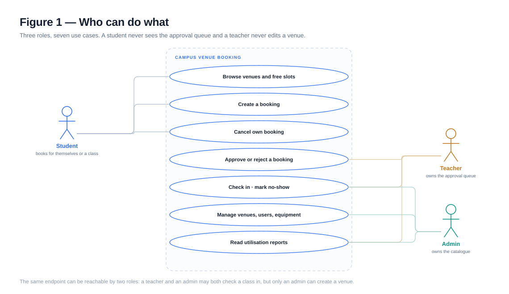
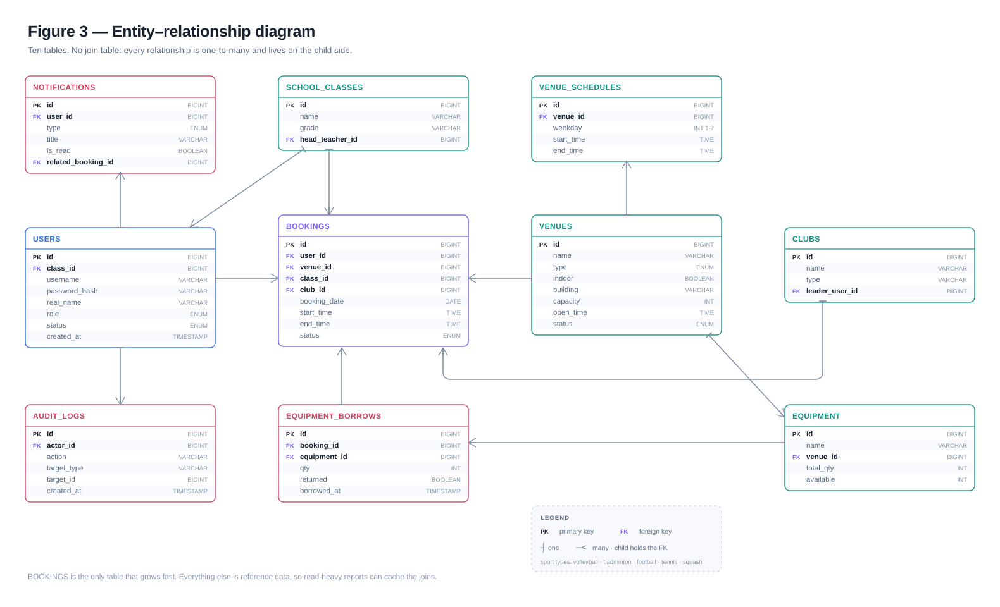
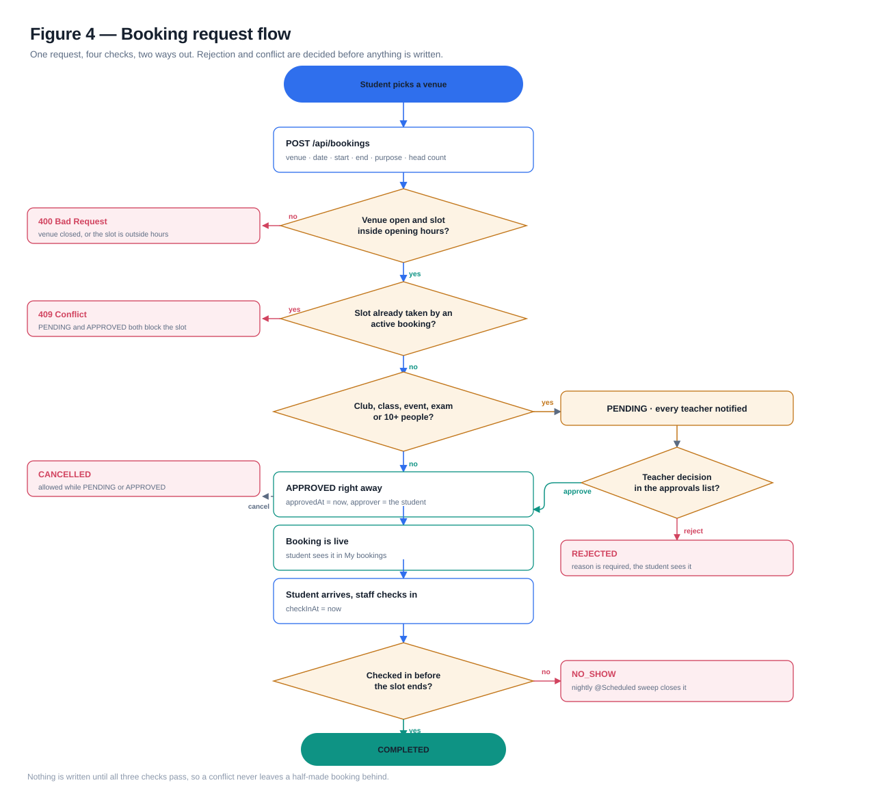
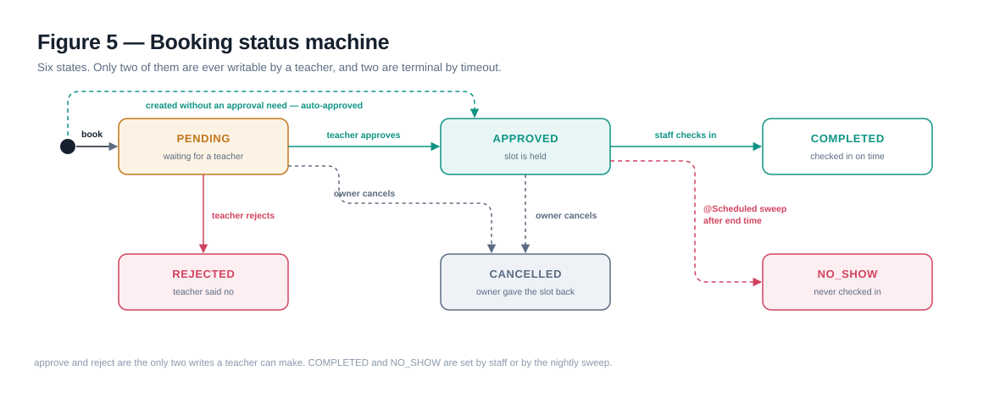
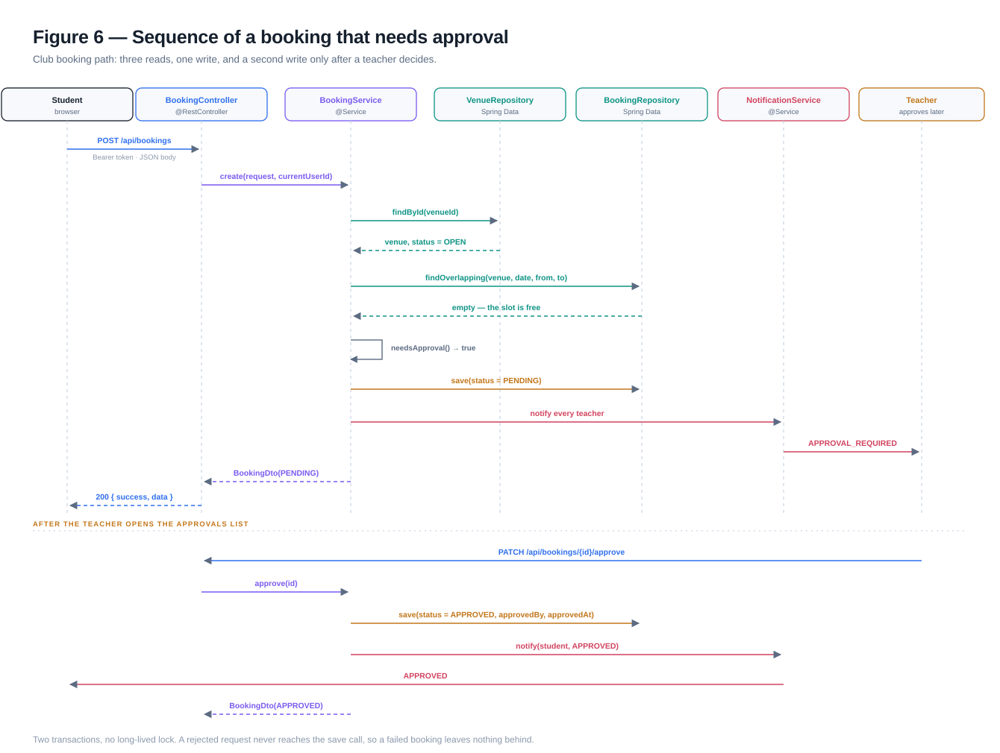

# Design of a Campus Venue Booking System

**Contents**

1. [The problem](#1-the-problem)
2. [Users and capabilities](#2-users-and-capabilities)
3. [Architecture](#3-architecture)
4. [Domain model](#4-domain-model)
5. [The booking request](#5-the-booking-request)
6. [Lifecycle of a booking](#6-lifecycle-of-a-booking)
7. [One request, layer by layer](#7-one-request-layer-by-layer)
8. [API design](#8-api-design)
9. [Security](#9-security)
10. [Time, scheduling and other awkward parts](#10-time-scheduling-and-other-awkward-parts)
11. [Testing](#11-testing)
12. [Limits and next steps](#12-limits-and-next-steps)

---

## 1. The problem

A school has six sports venues and one shared timetable. Before this system, booking one meant
finding the teacher who keeps the paper schedule, and the answer to "is the indoor tennis court
free on Thursday at four" depended on who you asked.

Three things make this harder than a calendar app:

- **The venues are not interchangeable.** A squash court holds two people; the football pitch
  holds twenty-two. Capacity and surface decide who can use what.
- **Some bookings need a decision.** Two students playing badminton for an hour is routine. A club
  taking the football pitch every Wednesday, or a PE exam that closes a venue for a morning, is
  not — someone has to weigh it against everyone else.
- **A slot that is booked but unused is worse than a free slot.** If nobody turns up, the venue sat
  empty while other people were told it was taken. The system has to notice.

The design below answers those three points: a typed venue catalogue, a two-speed approval rule,
and a status machine that ends unused bookings on its own.

**Scope.** One school, one database, three roles. No payments, no external calendar sync, no
multi-tenant isolation. Those are listed in [§12](#12-limits-and-next-steps) rather than quietly
half-built.

## 2. Users and capabilities

Three roles, and the boundaries between them are the whole access model.



| Capability | Student | Teacher | Admin |
| --- | --- | --- | --- |
| Browse venues and availability | yes | yes | yes |
| Create a booking | yes | yes | yes |
| Cancel own booking | yes | yes | yes |
| See every booking | no | yes | yes |
| Approve or reject | no | yes | yes |
| Check in, mark no-show | no | yes | yes |
| Manage venues and equipment | no | no | yes |
| Manage users | no | no | yes |
| Read reports | no | yes | yes |

Two rules are enforced twice, once in the route guard and once in the service. The client check is
for the user's benefit; the server check is the real one, because the client is just a browser.

A student can never read another student's booking, even by guessing an id. That is enforced in
`BookingService.checkCanRead`, not in the query, so it also holds for `GET /api/bookings/{id}`.

## 3. Architecture

Four layers, one direction of travel. A request goes down, a DTO comes back up, and nothing in the
API layer holds business state.


| Layer | Holds | Does not hold |
| --- | --- | --- |
| Client (Vue 3) | views, route guards, token, formatting | business rules |
| API (Spring MVC) | routing, validation, role checks, HTTP shape | queries, transactions |
| Service | rules, conflict detection, state transitions, notifications | HTTP concepts |
| Persistence (JPA) | mapping, queries | decisions |

**Why this split.** The rules that matter — overlap, approval, no-show — are the ones that must
survive a UI rewrite. Putting them behind a service interface means the Vue client can be replaced
without touching them, and the integration test can call them through HTTP without a browser.

**Why entities never leave the service.** Each layer boundary is a DTO (`VenueDto`, `BookingDto`,
…). Returning a JPA entity would leak lazy state and let a client see fields it should not. The
mapping is boring code, which is exactly what you want at a boundary.

**Cross-cutting pieces** sit to the side rather than inside the layers:

- `JwtService` + `JwtAuthenticationFilter` — issue and verify tokens, fill the security context.
- `GlobalExceptionHandler` — one place that turns an exception into an error envelope.
- `AuditService` — append-only trail, called by the services that change state.
- `SchedulerService` — the only thing that writes without a user behind it.

### Request path

1. Vite proxies `/api` to `:8080` in development; in production nginx serves the static build and
   proxies the same prefix, so the client never learns the API's real origin.
2. `JwtAuthenticationFilter` reads the `Authorization` header, verifies the signature, and puts an
   `AuthUser` in the security context. A bad token is ignored, not rejected — the request simply
   continues as anonymous and the authorization rules decide what happens next.
3. The controller validates the body (`@Valid`), calls one service method, and wraps the result in
   `ApiResponse`.
4. The service does the work inside a transaction where it writes more than once.
5. Exceptions travel back through `GlobalExceptionHandler` and become `ApiError`.

## 4. Domain model

Ten tables. There is no join table anywhere, because every relationship in this domain is
one-to-many and the child can hold the foreign key.



### The centre: `bookings`

One row per request, and the only table that grows quickly. Everything a decision needs is copied
onto the row — the venue, the date, the time window, who asked, why, and how many people. Nothing
about a booking is derived from the venue at read time, because the venue can change later and a
booking should still say what was agreed.

Time is stored as a **date plus two local times**, not as two timestamps. A school day is a local
concept: 16:00 means 16:00 in the school's timezone, and daylight saving should not move a booking
by an hour. Converting to an instant happens only for audit fields (`approvedAt`, `checkInAt`).

### Reference data

| Table | Why it exists | Notable constraint |
| --- | --- | --- |
| `venues` | catalogue: type, indoor, building, capacity, hours, rules | `status` blocks booking without deleting history |
| `venue_schedules` | recurring weekly windows, one row per weekday | a booking is only offered inside a window |
| `users` | accounts with a role and a status | `username` unique, password stored as a BCrypt hash |
| `school_classes` | the class a student belongs to | a class booking is a group booking |
| `clubs` | after-school clubs | a club booking always needs approval |
| `equipment` | rackets and balls per venue, with a stock counter | `available <= total` |
| `equipment_borrows` | stock lent against a booking | returning is idempotent |
| `notifications` | in-app inbox | `is_read` per row, not per user |
| `audit_logs` | who changed what, when | written by the service, never edited |

### Invariants the code relies on

- A booking's window lies inside the venue's opening hours *and* inside a `venue_schedules` window
  for that weekday.
- No two bookings with status `PENDING` or `APPROVED` overlap on the same venue and date.
- `REJECTED` and `CANCELLED` never block a slot, which is what makes "cancel and rebook" work.
- A booking in a terminal state never changes again — every transition method checks the current
  status first.

### Why not a `booking_slots` table

The obvious alternative is to materialise every hour as a row and mark it taken. It makes the
overlap query trivial and the writes complicated: creating a two-hour booking means inserting two
rows, cancelling means deleting them, and partial failures leave gaps. With a campus-sized dataset
(tens of thousands of rows a year), an overlap query on `(venue_id, booking_date)` is fast enough,
and the state lives in one place.

## 5. The booking request

A request passes four checks in a fixed order, cheapest first, and every failed check returns
before anything is written.



| Check | Failure | Why it is here |
| --- | --- | --- |
| venue exists and is open | `400` | the cheapest reason to say no |
| end after start, inside opening hours | `400` | a malformed request should not reach a query |
| no overlapping active booking | `409` | the only check that needs the database |
| approval needed? | not a failure, a fork | decides `PENDING` vs `APPROVED` |

**The approval rule** lives in one method and reads like a sentence:

> A request needs approval when it takes the venue away from other people: a class, a club, an
> event or exam slot, or a group of ten and more.

Small free play is confirmed immediately because a rule that makes two students wait for a teacher
is a rule people route around. Everything larger gets a human, because that is the only way to
balance a club against a PE class for the same hour.

**Conflict detection** is a single query:

```sql
select b from Booking b
 where b.venueId = :venueId
   and b.bookingDate = :date
   and b.status not in (REJECTED, CANCELLED)
   and b.startTime < :end
   and b.endTime   > :start
```

The two inequalities are the standard interval-overlap test. Back-to-back bookings (10:00–11:00 and
11:00–12:00) do not overlap, which is what the school expects.

There is a real race here: two requests for the same slot, arriving together, both pass the check
before either commits. The default isolation level does not prevent it. The honest options are a
unique constraint on the slot, a pessimistic lock on the venue row, or accepting the race at
campus scale. This build accepts it and says so — see [§12](#12-limits-and-next-steps).

## 6. Lifecycle of a booking

Six states, and only four transitions that a person can trigger.



| From | To | Trigger | Who |
| --- | --- | --- | --- |
| — | `PENDING` | create, needs approval | student |
| — | `APPROVED` | create, small free play | student (auto) |
| `PENDING` | `APPROVED` | approve | teacher or admin |
| `PENDING` | `REJECTED` | reject, with a reason | teacher or admin |
| `PENDING` / `APPROVED` | `CANCELLED` | cancel | owner |
| `APPROVED` | `COMPLETED` | check in | teacher or admin |
| `APPROVED` | `NO_SHOW` | sweep, past the end time | scheduler |

Two properties matter:

- **Terminal means terminal.** `REJECTED`, `CANCELLED`, `COMPLETED` and `NO_SHOW` are never written
  again. `COMPLETED` is deliberately not "used" — attendance is recorded once, and editing history
  is a different feature.
- **The sweep is the only writer without a user.** It runs every minute, looks for `APPROVED`
  bookings whose end time has passed, and marks them `NO_SHOW` with an audit entry whose actor is
  `null`. That null is the honest way to say "nobody did this".

Cancelling releases equipment: the stock counter goes back up, capped at `total` so a double
cancel cannot inflate it.

## 7. One request, layer by layer

The club-booking path, which is the interesting one because it writes twice.



The first transaction ends when the request returns `PENDING`. The second starts when a teacher
approves. Nothing is locked in between, so a teacher leaving the tab open overnight costs nothing.

Note what the controller does *not* do: it does not check whether the venue is open, whether the
slot is free, or whether approval is needed. It authenticates, validates the shape of the body, and
delegates.

## 8. API design

One prefix, one envelope, one error shape. The full endpoint list is in
[`api.md`](api.md); this section explains the conventions.

### Envelope

```json
{ "success": true, "data": { }, "message": "ok", "timestamp": "2026-10-21T08:30:00Z" }
```

Lists are paged and wrapped once more:

```json
{ "success": true,
  "data": { "content": [], "page": 0, "size": 20, "totalElements": 0, "totalPages": 0, "last": true } }
```

### Errors

```json
{ "success": false, "error": { "code": "CONFLICT", "message": "That slot is already booked", "details": [] } }
```

| Code | Status | When |
| --- | --- | --- |
| `BAD_REQUEST` | 400 | the request breaks a rule (closed venue, bad time window) |
| `VALIDATION_ERROR` | 400 | a field is missing or malformed; `details` lists them |
| `UNAUTHORIZED` | 401 | no token, or an expired one |
| `FORBIDDEN` | 403 | the role or the owner check failed |
| `NOT_FOUND` | 404 | no such row |
| `CONFLICT` | 409 | the slot is taken |
| `INTERNAL_ERROR` | 500 | anything unplanned; the message never leaks internals |

The distinction between `400` and `409` is deliberate. `400` means the request is wrong. `409` means
the request was fine but the world changed — the client should re-read availability and let the user
pick again.

### Resources

Verb-first paths for state changes (`POST /api/bookings/{id}/approve`) rather than `PATCH` with a
status field. A status field invites clients to send `APPROVED` on a booking that is already
`COMPLETED`; a named action is a smaller door, and it is easier to guard.

### Actions the response advertises

`BookingDto` carries `canCancel` and `canApprove`, computed on the server from the status and the
caller. The client renders buttons from those flags instead of re-implementing the state machine in
JavaScript. Two implementations of the same rule is how UIs drift out of sync with backends.

## 9. Security

**Authentication.** Email-and-password is not needed here — a school issues accounts. `POST
/api/auth/login` returns an HS256 JWT with the user id as subject, the role as a claim, and an
expiry (24 hours by default). The signature is computed with `HmacSHA256` over
`base64url(header).base64url(payload)`; verification is a constant-time comparison.

The JWT library was left out on purpose. The token format is thirty lines of code, and writing it
makes the failure modes visible — including the one this project actually hit: a parser that
assumed every claim value was a quoted string, which silently rejected every request because `iat`
and `exp` are numbers.

**Passwords.** BCrypt with the default strength from `BCryptPasswordEncoder`. The hash is never in a
DTO; `UserDto` has no password field at all.

**Authorization.** Two layers: the security chain decides whether a request may proceed at all, and
the service decides whether *this* user may touch *this* row. The second layer is the one that
matters for object-level access, and it is why `GET /api/bookings/{id}` is safe.

**Transport and origin.** CORS allows exactly one origin from configuration, with credentials off
because the token travels in a header rather than a cookie. There is no CSRF token for the same
reason; there is nothing to forge.

**What is deliberately absent.** No refresh tokens (a 24-hour token and a re-login is fine for a
school), no rate limiting on login, no account lockout. Those belong to a deployment behind a
gateway, and pretending otherwise in application code is worse than leaving them out.

## 10. Time, scheduling and other awkward parts

**Opening hours versus the weekly timetable.** A venue has `openTime`/`closeTime` and a set of
weekly windows. The first is what the sign on the door says; the second is when the venue is
actually bookable (a pitch may be closed for maintenance on Sunday mornings). Availability is
generated from the windows, and a booking is validated against both.

**Slot generation.** `VenueService.availability` walks the requested dates, finds the window for
that weekday, and slices it into one-hour slots, clipping the last one at the window's end. Bookings
for the whole range are fetched in one query and matched in memory; an earlier version queried per
slot, which is fine for a week and embarrassing for a term.

**The sweep.** `@Scheduled(fixedDelay = 60_000)` looks for approved bookings whose end time has
passed and marks them `NO_SHOW`. One minute of latency is invisible to users and keeps the query
trivial. The sweep is idempotent: it only touches bookings still in `APPROVED`.

**Timezones.** Everything is a `LocalDate`/`LocalTime` in the school's timezone, so the app does not
depend on the server's. The trade-off is that exporting to another timezone needs an explicit
conversion at the edge.

**Equipment stock.** `available` is a counter, not a derived count, because a borrow can be
returned early and the counter is what the desk looks at. Cancelling restores it. A borrow of more
than `available` is rejected before it is written.

## 11. Testing

`CampusVenueApplicationTests` runs against the real Spring context, the real security chain, and
H2, with `MockMvc` driving HTTP. One test checks that the context starts; the other walks the whole
story:

```
login admin, student, teacher
  → admin creates a venue                       200
  → availability for tomorrow                   200
  → student books 10:00–11:00 free play         200, APPROVED
  → same request again                          409
  → student books 12:00–13:00 club training     200, PENDING
  → teacher approves                            200, APPROVED
  → utilisation report contains the venue       total >= 1
  → student cancels the first booking           200, CANCELLED
```

That test is worth more than a dozen unit tests here, because every failure this project actually
had was at a seam: a JSON parser that mis-read numbers, a security filter that authenticated
nobody, a report ordered differently than the test assumed. All three were invisible to service-level
tests.

What is *not* tested: the frontend (no component tests), the scheduler's timing (only its effect,
indirectly), and concurrency. Those are honest gaps, listed below.

## 12. Limits and next steps

| Limit | Consequence | The fix, when it matters |
| --- | --- | --- |
| Overlap check races under concurrency | two simultaneous requests can both win | a unique index on `(venue_id, booking_date, start_time)` plus a `@Version` column |
| No schema migrations | `ddl-auto` is `create-drop` in dev, `validate` in prod | add Flyway and a baseline migration |
| No refresh tokens or revocation | a stolen token is valid until it expires | shorter expiry plus a revocation list |
| Reports are computed per request | fine for a term, slow for years | materialise a monthly summary table |
| Client checks are advisory | a determined user can call the API directly | already handled: the server re-checks everything |
| No file upload | venue photos are URLs, not uploads | object storage plus a signed URL |
| Single school | one database, one timetable | tenant id on the reference tables |

The next three things worth building, in order: a Flyway baseline so the schema is not a side
effect of the entities; the unique index plus optimistic locking for the overlap race; and a
per-venue calendar export so students can see their bookings outside the app.

---

*Figures in this document are hand-built SVG, in `docs/diagrams/`. They open in any browser and
scale without blurring.*
